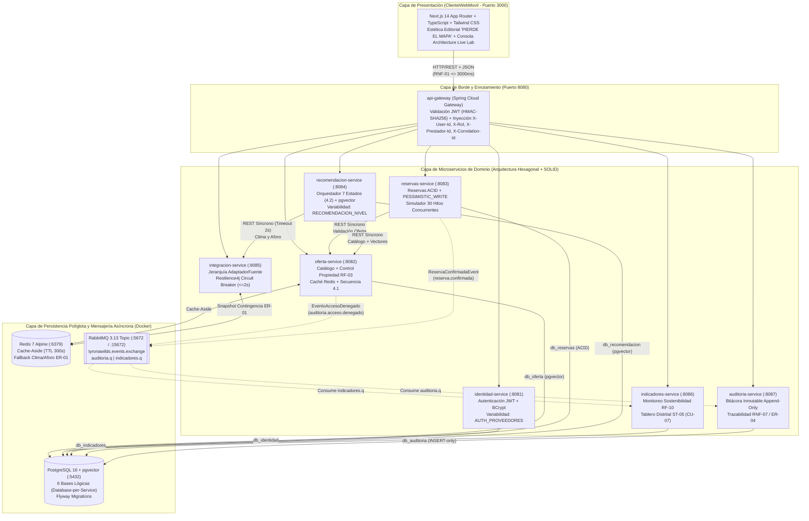
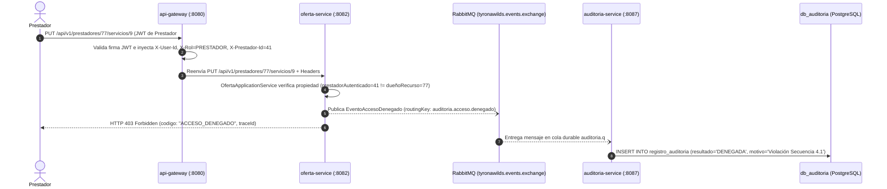
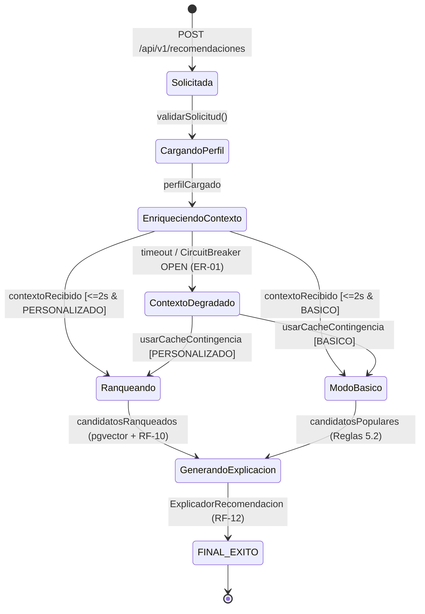

# TYRONAWILDS™ (`PlataformaTurismoSM`)

> **"PIERDE EL MAPA. DESCUBRE EL ORIGEN: SIERRA NEVADA, PARQUE TAYRONA & CARIBE."**  
> **Plataforma Digital para la Gestión Integrada, Resiliente y Sostenible del Turismo en el Distrito de Santa Marta, Colombia.**


---

## 1. Visión del Sistema y Propósito Arquitectónico

**TyronaWilds (`PlataformaTurismoSM`)** es una plataforma distribuida de grado empresarial diseñada en el marco de la cátedra de **Arquitectura de Software** del Programa de **Ingeniería de Sistemas de la Universidad del Magdalena** (Docente: **Ing. Carlos Oliveros**).

El sistema resuelve tres problemáticas estructurales del ecosistema turístico de Santa Marta (Sierra Nevada, Ciudad Perdida - Teyuna, Parque Nacional Natural Tayrona, Minca, Bonda y Taganga):
1. **Sobrecarga Ecológica Estacional (`RF-10`)**: Monitoreo en tiempo real de la capacidad de carga de cada ecosistema y desconcentración inteligente de flujos turísticos hacia rutas sostenibles (p. ej., Minca y Río Don Diego cuando Cabo San Juan supera el 80% de ocupación).
2. **Sobreventa en Reservas de Cupo Limitado (`RNF-13`, `ER-02`)**: Control transaccional **ACID** con bloqueo pesimista (`SELECT ... FOR UPDATE`) y optimista (`@Version`) sobre PostgreSQL, garantizando **cero sobreasignación** ante ráfagas concurrentes de reservas.
3. **Asimetría Tecnológica y Desconexión de Servicios Externos (`ER-01`, `RF-08`, `RF-12`)**: Motor de recomendación de **IA Explicable** con búsqueda vectorial (`pgvector`), máquina de estados determinista y tolerancia a fallos mediante **Circuit Breaker (`Resilience4j`)** con degradación elegante hacia **Redis**.

---

## 2. Diagrama de Arquitectura de Microservicios (C4 Contenedores)



---

## 3. Catálogo de Módulos, Puertos, Bases de Datos y Responsables

| # | Módulo Maven / Carpeta | Puerto | Base de Datos / Infra | Patrones y Estándares Clave | Responsable Principal |
| :-: | :--- | :-: | :--- | :--- | :--- |
| 0 | `backend/contratos-compartidos` | `JAR` | Librería Común | `ApiErrorResponse` (`ER-04`/`ER-05`), `SecurityHeaders`, Eventos RabbitMQ | **Equipo Completo** |
| 1 | `backend/api-gateway` | `8080` | Stateless Edge | Spring Cloud Gateway, Filtro JWT Reactivo, Propagación de Identidad y `X-Correlation-Id` | **Sebastián Abaonza** |
| 2 | `backend/identidad-service` | `8081` | `db_identidad` | Hexagonal, `ProveedorAutenticacionPort` (Strategy), Variabilidad `AUTH_PROVEEDORES` | **Sebastián Abaonza** |
| 3 | `backend/auditoria-service` | `8087` | `db_auditoria` | Consumidor RabbitMQ (`auditoria.q`), Tabla Append-Only (`INSERT`), `RNF-07` | **Sebastián Abaonza** |
| 4 | `backend/oferta-service` | `8082` | `db_oferta` + Redis | Control de Propiedad (`prestadorId`), Secuencia 4.1 (`403` + Evento RabbitMQ), `pgvector` | **Melanye Mejía** |
| 5 | `backend/integracion-service` | `8085` | Redis (`ER-01`) | Jerarquía `AdaptadorFuente` (`Clima`, `Aforo`, `Eventos`), `Resilience4j @CircuitBreaker` | **Melanye Mejía** |
| 6 | `backend/reservas-service` | `8083` | `db_reservas` | Transacciones ACID, Bloqueo Pesimista `SELECT ... FOR UPDATE`, Simulador 30 Hilos (`RNF-13`) | **Fabián Valderrama** |
| 7 | `backend/recomendacion-service` | `8084` | `db_recomendacion` | Máquina de 7 Estados (`Punto 4.2`), Similitud Coseno `pgvector`, Variabilidad `5.2`, `RF-12` | **Rigoberto Varilla** |
| 8 | `backend/indicadores-service` | `8086` | `db_indicadores` | Monitoreo de Capacidad Ecológica (`RF-10`, `CU-07`), Consumidor RabbitMQ (`indicadores.q`) | **Rigoberto Varilla** |
| 9 | `frontend/` (`ClienteWebMovil`) | `3000` | Next.js 14 | Dirección de Arte **"PIERDE EL MAPA"**, Telemetría HUD, Consola **Architecture Live Lab** | **Equipo Completo** |

---

## 4. Decisiones de Ingeniería e Implementación Técnica

### 4.1. Arquitectura Hexagonal (Ports & Adapters) y Principios SOLID
Todos los microservicios del monorepo respetan una separación estricta en tres capas concéntricas sin fugas de infraestructura hacia el dominio:
- **`domain.model` / `domain.port.in` / `domain.port.out` / `domain.exception`**: Modelos de negocio puros, interfaces de casos de uso y puertos de salida. Ninguna clase de dominio acopla anotaciones de transporte web.
- **`application.service`**: Orquestadores de casos de uso con inyección por constructor (cero uso de `@Autowired` en campos, cumpliendo **DIP**).
  - *Ejemplo real*: [`OfertaApplicationService`](file:///c:/Users/abaon/tyronawilds/backend/oferta-service/src/main/java/co/edu/unimagdalena/tyronawilds/oferta/application/service/OfertaApplicationService.java) depende exclusivamente de [`OfertaRepositoryPort`](file:///c:/Users/abaon/tyronawilds/backend/oferta-service/src/main/java/co/edu/unimagdalena/tyronawilds/oferta/domain/port/out/OfertaRepositoryPort.java) y [`EventoSeguridadPublisherPort`](file:///c:/Users/abaon/tyronawilds/backend/oferta-service/src/main/java/co/edu/unimagdalena/tyronawilds/oferta/domain/port/out/EventoSeguridadPublisherPort.java).
- **`infrastructure.adapter.in.web` / `messaging` / `out.persistence`**: Controladores REST que reciben y retornan únicamente `record` DTOs inmutables, manejadores globales `@RestControllerAdvice` que devuelven [`ApiErrorResponse`](file:///c:/Users/abaon/tyronawilds/backend/contratos-compartidos/src/main/java/co/edu/unimagdalena/tyronawilds/contratos/dto/ApiErrorResponse.java) sin exponer trazas internas (`ER-05`), y migraciones versionadas con **Flyway** (`ddl-auto: validate`).

---

### 4.2. Transacciones ACID y Control de Concurrencia (`RNF-13`, `ER-02`)
En [`reservas-service`](file:///c:/Users/abaon/tyronawilds/backend/reservas-service/src/main/java/co/edu/unimagdalena/tyronawilds/reservas/application/service/ReservaApplicationService.java), la creación de una reserva protege el inventario de cupos mediante tres barreras complementarias:
1. **Bloqueo Pesimista en Base de Datos (`PESSIMISTIC_WRITE`)**: [`SpringDataDisponibilidadRepository`](file:///c:/Users/abaon/tyronawilds/backend/reservas-service/src/main/java/co/edu/unimagdalena/tyronawilds/reservas/infrastructure/adapter/out/persistence/SpringDataDisponibilidadRepository.java) ejecuta `@Lock(LockModeType.PESSIMISTIC_WRITE)` (`SELECT ... FOR UPDATE`), serializando el acceso concurrente sobre la fila del horario solicitado dentro de `@Transactional(isolation = Isolation.READ_COMMITTED)`.
2. **Restricción de Integridad Relacional**: En [`V1__init_reservas_schema.sql`](file:///c:/Users/abaon/tyronawilds/backend/reservas-service/src/main/resources/db/migration/V1__init_reservas_schema.sql), la tabla `disponibilidad` define `CHECK (cupos_disponibles >= 0 AND cupos_disponibles <= capacidad_total)`.
3. **Respuesta Determinista `409 Conflict` (`ER-02`)**: Cuando los cupos se agotan, [`CupoAgotadoException`](file:///c:/Users/abaon/tyronawilds/backend/reservas-service/src/main/java/co/edu/unimagdalena/tyronawilds/reservas/domain/exception/CupoAgotadoException.java) consulta horarios alternativos con cupo disponible para la misma actividad y los incluye en el payload del error `409 Conflict`.
4. **Verificación Automatizada y en Vivo**: El test de integración [`ReservaConcurrenciaIntegrationTest`](file:///c:/Users/abaon/tyronawilds/backend/reservas-service/src/test/java/co/edu/unimagdalena/tyronawilds/reservas/ReservaConcurrenciaIntegrationTest.java) y el endpoint `POST /api/v1/reservas/simulacion-concurrencia` disparan **30 hilos simultáneos (`CountDownLatch`)** contra un horario con **5 cupos**, confirmando exactamente **5 reservas (`201 Created`)**, **25 rechazos (`409 Conflict`)** y **0 cupos negativos**.

---

### 4.3. Seguridad en Profundidad y Secuencia 4.1 (`AC-05`, `ER-04`, `RNF-07`)
Implementa paso a paso el **Diagrama de Secuencia 4.1 del Laboratorio 3** (Intento de modificación no autorizada de un servicio turístico ajeno):



---

### 4.4. Resiliencia con Circuit Breaker (`ER-01`) y Máquina de Estados de IA (`Punto 4.2`)
- En [`integracion-service`](file:///c:/Users/abaon/tyronawilds/backend/integracion-service/src/main/java/co/edu/unimagdalena/tyronawilds/integracion/application/service/IntegracionContextualService.java), la jerarquía polimórfica [`AdaptadorFuente`](file:///c:/Users/abaon/tyronawilds/backend/integracion-service/src/main/java/co/edu/unimagdalena/tyronawilds/integracion/domain/port/out/AdaptadorFuente.java) (`AdaptadorClima`, `AdaptadorAforo`, `AdaptadorEventos`) está protegida por `@CircuitBreaker(name = "proveedorExternoClima", fallbackMethod = "obtenerContextoDesdeFallback")`. Si el proveedor externo supera el timeout de **2 segundos** o entra en fallo simulado, responde inmediatamente desde el snapshot en **Redis** (`fuenteDatos: "REDIS_CACHE_FALLBACK"`).
- En [`recomendacion-service`](file:///c:/Users/abaon/tyronawilds/backend/recomendacion-service/src/main/java/co/edu/unimagdalena/tyronawilds/recomendacion/application/service/OrquestadorRecomendacionService.java), el `OrquestadorRecomendacion` ejecuta y registra la traza completa de la **Máquina de Estados Comprensiva (Punto 4.2 del Laboratorio 3)**:



---

### 4.5. Puntos de Variabilidad Arquitectónica (`Punto 5.2` del Laboratorio 3)
1. **`NIVEL_RECOMENDACION_IA` (`recomendacion-service`)**:
   - Controlado por `app.recomendacion.nivel: ${RECOMENDACION_NIVEL:PERSONALIZADO}` en [`application.yml`](file:///c:/Users/abaon/tyronawilds/backend/recomendacion-service/src/main/resources/application.yml) y conmutable en caliente mediante `POST /api/v1/recomendaciones/configuracion`.
   - Alterna entre [`MotorRecomendacionPersonalizadoAdapter`](file:///c:/Users/abaon/tyronawilds/backend/recomendacion-service/src/main/java/co/edu/unimagdalena/tyronawilds/recomendacion/infrastructure/adapter/out/ia/MotorRecomendacionPersonalizadoAdapter.java) (similitud coseno `pgvector` + penalización ecológica `RF-10`) y [`MotorRecomendacionBasicoAdapter`](file:///c:/Users/abaon/tyronawilds/backend/recomendacion-service/src/main/java/co/edu/unimagdalena/tyronawilds/recomendacion/infrastructure/adapter/out/ia/MotorRecomendacionBasicoAdapter.java) (heurística ligera sin costo de inferencia vectorial).
2. **`PROVEEDOR_AUTENTICACION` (`identidad-service`)**:
   - Controlado por `app.auth.proveedores: ${AUTH_PROVEEDORES:local,google}` en [`application.yml`](file:///c:/Users/abaon/tyronawilds/backend/identidad-service/src/main/resources/application.yml).
   - Resuelve dinámicamente las implementaciones de [`ProveedorAutenticacionPort`](file:///c:/Users/abaon/tyronawilds/backend/identidad-service/src/main/java/co/edu/unimagdalena/tyronawilds/identidad/domain/port/out/ProveedorAutenticacionPort.java): [`LocalProveedorAutenticacionAdapter`](file:///c:/Users/abaon/tyronawilds/backend/identidad-service/src/main/java/co/edu/unimagdalena/tyronawilds/identidad/infrastructure/adapter/out/security/LocalProveedorAutenticacionAdapter.java) (BCrypt) y [`GoogleOAuth2ProveedorAdapter`](file:///c:/Users/abaon/tyronawilds/backend/identidad-service/src/main/java/co/edu/unimagdalena/tyronawilds/identidad/infrastructure/adapter/out/security/GoogleOAuth2ProveedorAdapter.java) (OAuth2).

---

## 5. Guía Rápida de Despliegue y Ejecución

### Requisitos Previos
- **Docker Desktop** activo (PostgreSQL 16 + `pgvector`, Redis 7, RabbitMQ 3.13).
- **JDK 21** y **Maven 3.9+**.
- **Node.js 20+** y **npm**.

### Opción A: Arranque Automatizado en 1 Comando (Windows PowerShell)
```powershell
.\start-tyronawilds.ps1
```
Para detener todos los procesos y contenedores limpiamente:
```powershell
.\stop-tyronawilds.ps1
```

### Opción B: Ejecución Paso a Paso Manual
1. **Levantar la infraestructura Docker**:
   ```powershell
   docker compose up -d
   ```
2. **Compilar y ejecutar las pruebas de los 9 módulos del Backend**:
   ```powershell
   cd backend
   mvn clean test install
   ```
3. **Levantar el Frontend (`ClienteWebMovil`)**:
   ```powershell
   cd frontend
   npm.cmd install
   npm.cmd run dev
   ```
   Abrir en el navegador: **http://localhost:3000**

---

## 6. Credenciales Semilla de Prueba (Password: `Tyrona2026*`)

| Actor del Sistema | Correo Electrónico | Contraseña | Rol JWT | `prestadorId` / Código Público | Propósito de Prueba |
| :--- | :--- | :--- | :--- | :--- | :--- |
| **Turista** (`ST-01`) | `turista@tyronawilds.co` | `Tyrona2026*` | `TURISTA` | `N/A` | Exploración de catálogo, reservas ACID (`CU-03`) y recomendaciones IA (`CU-06`) |
| **Prestador Dueño** (`ST-02`) | `tayrona@tyronawilds.co` | `Tyrona2026*` | `PRESTADOR` | `00000000-0000-0000-0000-000000000077` (`#77`) | Propietario legítimo del Servicio `#9` (Ciudad Perdida - Teyuna) -> `200 OK` |
| **Prestador Intruso** (`ST-03`) | `intruso@tyronawilds.co` | `Tyrona2026*` | `PRESTADOR` | `00000000-0000-0000-0000-000000000041` (`#41`) | Actor atacante en la **Secuencia 4.1** contra el Servicio `#9` del Prestador `#77` -> `403 Forbidden` |
| **Administrador** (`ST-04`) | `admin@tyronawilds.co` | `Tyrona2026*` | `ADMIN` | `N/A` | Supervisión global y consulta de bitácora en `auditoria-service` |
| **Gestor Distrital** (`ST-05`) | `gestor@tyronawilds.co` | `Tyrona2026*` | `GESTOR_TURISTICO` | `N/A` | Monitoreo de indicadores de capacidad ecológica (`CU-07` / `RF-10`) |

---

## 7. Créditos Académicos

- **Universidad del Magdalena** — Facultad de Ingeniería — Programa de Ingeniería de Sistemas (Santa Marta D.T.C.H., Colombia).
- **Asignatura**: Arquitectura de Software — **Docente**: Ing. Carlos Oliveros.
- **Equipo de Arquitectura y Desarrollo**:
  - **Sebastián Abaonza** (`api-gateway`, `identidad-service`, `auditoria-service`, Infraestructura Docker & DevOps).
  - **Melanye Mejía** (`oferta-service`, `integracion-service`, Resiliencia `CircuitBreaker` & Caché Redis).
  - **Fabián Valderrama** (`reservas-service`, Concurrencia ACID, Bloqueo Pesimista & Pruebas Multihilo).
  - **Rigoberto Varilla** (`recomendacion-service`, `indicadores-service`, Máquina de Estados IA, `pgvector` & Sostenibilidad).
