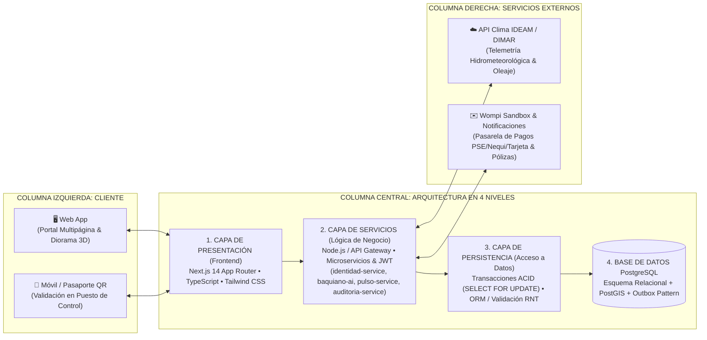

# Tyrona Wilds — Portal Eco-Turístico Inteligente & Diorama Topográfico 3D del Magdalena

[](https://tyronawilds.vercel.app/)
[](https://github.com/Sabaonza/tyronawilds/releases/tag/v2.2.2)
[]()
[]()

> **Sustentación Oficial de Ingeniería de Sistemas — Universidad del Magdalena**  
> **Póster Científico Oficial (Formato A0):** [`docs/poster/Poster_TyronaWilds_v2.2.2.pptx`](./docs/poster/Poster_TyronaWilds_v2.2.2.pptx) | [`docs/poster/POSTER_SPECIFICATION.md`](./docs/poster/POSTER_SPECIFICATION.md)

---

## 1. Propósito del Sistema

**Tyrona Wilds** es una plataforma web y ecosistema de microservicios transaccionales diseñado para modernizar la operación turística sostenible en **Santa Marta, el Parque Nacional Natural Tayrona y la Sierra Nevada de Santa Marta** (desde el arrecife coralino a `0 msnm` hasta el Pico Cristóbal Colón a `5.775 msnm`).

El sistema resuelve tres problemáticas críticas del ecoturismo regional:
1. **Control estricto de capacidad de carga ecológica**: Reservas **ACID** con bloqueo pesimista (`SELECT ... FOR UPDATE`) y validación de cupos diarios PNN para evitar sobrecarga en senderos y playas protegidas.
2. **Mitigación de informalidad y riesgo operativo**: Validación automática del **Registro Nacional de Turismo (RNT)**, emisión de **Pasaporte Oficial de Expedición QR** con firma criptográfica (`SHA-256`) y póliza de asistencia obligatoria por pasajero.
3. **Asistencia inteligente y telemetría climática en tiempo real**: **Concierge Baquiano AI** y **Pulso Ambiental IDEAM / DIMAR** para evaluar ventanas climáticas, oleaje, caudal de ríos y pisos térmicos antes del ingreso a zonas agrestes.

---

## 2. Novedades de la Versión `v2.2.2`

- **Diorama Topográfico 3D Multicapa de Alta Precisión (`/`):**
  - Bloque tridimensional interactivo con corteza terrestre en 3D, batimetría del Mar Caribe con oleaje animado y **7 cotas hipsométricas reales (`translateZ(8px)` a `translateZ(92px)`)** desde el litoral hasta las nieves perpetuas (`5.775 msnm`).
  - Cuencas hidrográficas animadas (**Río Don Diego** y **Río Buritaca**) descendiendo desde la alta montaña hasta su desembocadura en el Caribe.
  - Conmutador instantáneo **Vista Relieve 3D / Vista Satelital 2D** con fotografía real de alta resolución y pines interactivos sincronizados.
  - **Perfil Longitudinal de Elevación (`0m → 5.775m`)** interactivo que traza rutas animadas y pendientes entre los 6 nodos estratégicos.
- **Fotografía 100% Real del Magdalena (`public/images/destinos/`):**
  - Banco fotográfico verificado desde Wikimedia Commons de **Cabo San Juan del Guía (Tayrona)**, **Teyuna — Ciudad Perdida**, **Minca**, **Cumbres de la Sierra Nevada**, **Río Don Diego** y **Bahía de Taganga**.
- **Modo Claro Editorial & Modo Oscuro Nocturno (`html.dark`):**
  - Paleta luminosa tropical inspirada en `colombia.travel` en Modo Claro y tema nocturno profundo (`#0B0F17`) con contraste accesible WCAG AAA en todas las páginas y modales.
- **Módulo de Reserva ACID, Wompi Sandbox & Pasaporte QR (`v2.2.2`):**
  - Contraste tipográfico perfeccionado en los 3 pasos del Checkout (`1. Selección de Salida & Titular PNN`, `2. Wompi Sandbox Pay`, `3. Pasaporte Oficial QR`), autocompletado con sesión verificada JWT y nómina dinámica de acompañantes.
- **Póster Académico A0 Automatizado (`docs/poster/Poster_TyronaWilds_v2.2.2.pptx`):**
  - Generador programático (`scripts/generate_poster.py` y `scripts/build_poster_v222.cjs`) con las 9 secciones oficiales de la rúbrica, diagrama visual de **Arquitectura en 3 Capas con íconos y escudos tecnológicos** (Sección 6) y capturas actualizadas del prototipo con QR a producción (Sección 7).

---

## 3. Arquitectura Seleccionada (Modelo de 3 Capas + Microservicios)

El sistema implementa una arquitectura desacoplada de **3 Capas Centrales** flanqueada por los canales **Cliente** y los **Servicios Externos**, idéntica a la especificación visual de la **Sección 6 del Póster (`Poster_TyronaWilds_v2.2.2.pptx`)**:



### Mapa de Rutas Multipágina (`frontend/src/app/`)

| Ruta | Módulo | Descripción Funcional |
| :--- | :--- | :--- |
| `/` | **Inicio & Diorama Topográfico 3D** | Hero cinematográfico de Santa Marta, Diorama 3D de 7 cotas + Satélite 2D + Perfil Longitudinal (`0m → 5.775m`), tarjetas editoriales y motor de reserva ACID. |
| `/expediciones` | **Catálogo & Filtros de Expediciones** | Buscador en tiempo real, filtros por piso térmico y dificultad, cupos PNN en vivo y apertura directa del Checkout en 3 pasos. |
| `/baquiano` | **Concierge Baquiano AI** | Planificador inteligente de travesías con recomendaciones de equipaje, preparación física, clima y rutas según el perfil del viajero. |
| `/pulso` | **Pulso Ambiental IDEAM / DIMAR** | Estación de monitoreo bioclimático por destino: temperatura, humedad, oleaje en nudos, caudal de ríos y estado de senderos. |
| `/login` | **Autenticación & Registro JWT** | Inicio de sesión y registro con cuentas demo de 1 clic (`Viajero Demo` y `Guía RNT Oficial`) y persistencia de sesión en todo el portal. |
| `/mis-reservas` | **Billetera de Pasaportes QR** | Historial de reservas confirmadas, descarga de **Pasaporte Oficial QR**, código de póliza PNN y estado de transacción Wompi. |
| `/operadores` | **Portal de Operadores & Guías RNT** | Verificación de credenciales RNT ante MinCIT, manifiesto de pasajeros asegurados y control de capacidad en ruta. |
| `/lab` | **Laboratorio de Estrés Concurrencia** | Simulador de ráfagas concurrentes (`Promise.all`) para demostrar prevención de sobreventa (`HTTP 201` vs `HTTP 409 Conflict`). |

---

## 4. Estructura del Repositorio

```text
tyronawilds/
├── frontend/                              # Aplicación Web Next.js 14 (App Router + TypeScript + Tailwind)
│   ├── public/images/destinos/            # Fotografías reales de Santa Marta (Wikimedia Commons)
│   └── src/
│       ├── app/                           # Rutas multipágina (/, /expediciones, /baquiano, /pulso, /login, /mis-reservas, /operadores, /lab)
│       ├── components/                    # Navbar, ThemeToggle, PasaporteExpedicionQr, AuthModal
│       ├── context/                       # AuthContext (JWT) y ThemeContext (Light/Dark Mode)
│       └── services/                      # Clientes de API, telemetría y persistencia local/remota
├── services/                              # Microservicios Backend (Node.js / Express / Python FastAPI)
│   ├── api-gateway/                       # Enrutamiento central, CORS, Rate Limiting y correlación
│   ├── identidad-service/                 # Autenticación JWT, roles y validación RNT
│   ├── baquiano-ai-service/               # Motor de recomendaciones y análisis de rutas
│   ├── pulso-service/                     # Telemetría ambiental y cupos ecológicos ACID
│   └── auditoria-service/                 # Trazabilidad inmutable de eventos y reservas
├── database/                              # Esquemas SQL PostgreSQL + PostGIS y migraciones
├── scripts/                               # Automatización del Póster A0 y descarga de activos reales
│   ├── generate_poster.py                 # Script Python (python-pptx + Pillow) para el póster A0
│   └── build_poster_v222.cjs              # Generador Node.js autónomo de íconos PNG y PPTX A0
└── docs/                                  # Documentación de Ingeniería y Sustentación
    ├── poster/
    │   ├── Poster_TyronaWilds_v2.2.2.pptx # Póster Científico Oficial en PowerPoint (A0)
    │   ├── POSTER_SPECIFICATION.md        # Especificación detallada de las 9 secciones del Póster
    │   └── assets/                        # Íconos de arquitectura, capturas y QR de alta resolución
    ├── GUION_SUSTENTACION_19_NOV.md       # Guion ejecutivo para la sustentación de Ingeniería
    └── MATRIZ_TRAZABILIDAD_PRODUCCION.md  # Matriz de trazabilidad de requerimientos y releases
```

---

## 5. Ejecución Local y Generación del Póster

### 5.1. Levantar el Frontend (`Next.js 14`)
```bash
cd frontend
npm install
npm run dev
```
Abrir `http://localhost:3000` en el navegador. Para validar el empaquetado de producción:
```bash
npm run build
```

### 5.2. Regenerar el Póster Científico A0 (`Poster_TyronaWilds_v2.2.2.pptx`)
El repositorio incluye tanto el script en Python (`python-pptx` + `Pillow`) como el empaquetador directo en Node.js:
```bash
# Opción A (Node.js directo — sin dependencias externas):
node scripts/build_poster_v222.cjs

# Opción B (Python con python-pptx y Pillow):
pip install python-pptx Pillow
python scripts/generate_poster.py
```

---

## 6. Historial de Releases (Estrategia Gitflow + SemVer)

Consulta el detalle completo en [`CHANGELOG.md`](./CHANGELOG.md).

| Tag SemVer | Rama Gitflow | Hito Principal |
| :--- | :--- | :--- |
| **`v2.2.2`** | `release/v2.2.2-full-poster-and-docs` | **Corrección de contraste en Checkout ACID, Póster A0 PPTX con íconos de arquitectura (Sección 6) + capturas (Sección 7) y documentación integral.** |
| **`v2.2.1`** | `fix/diorama-3d-and-ui-polish-v2.2.1` | Diorama Topográfico 3D de 7 cotas reales, vista Satélite 2D, Perfil Longitudinal `0m-5.775m` y mejoras de contraste en `/expediciones` y `/login`. |
| **`v2.2.0`** | `feat/3d-map-real-photos-darkmode-v2.2` | Fotografías 100% reales de Santa Marta (Wikimedia Commons), Modo Claro/Oscuro (`html.dark`) y relieve 3D interactivo. |
| **`v2.1.0`** | `feature/colombia-travel-editorial-v2.1` | Rediseño editorial luminoso inspirado en `colombia.travel`, nuevo isotipo vectorial `icon.svg` y tarjetas de destino inmersivas. |
| **`v2.0.0`** | `feature/organic-portal-v2` | Portal orgánico multipágina, navegación unificada con sesión JWT y billetera de reservas `/mis-reservas`. |
| **`v1.7.0`** | `feature/cinematic-hero-multipage` | Hero cinematográfico de las cumbres de Santa Marta y separación en rutas dedicadas (`/expediciones`, `/baquiano`, `/pulso`). |
| **`v1.1.0` – `v1.6.1`** | `feat/*` / `fix/*` | Microservicios base, motor ACID de cupos, pasarela Wompi Sandbox, Pasaporte QR y despliegue continuo en Vercel. |
