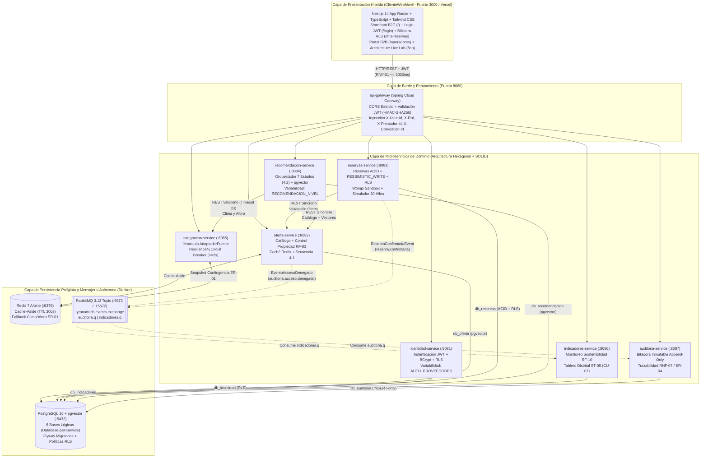
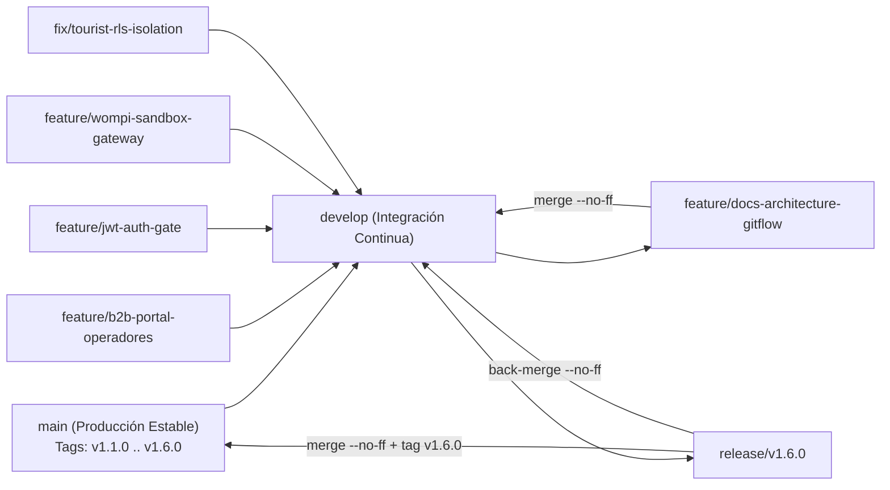

# TYRONAWILDS™ (`PlataformaTurismoSM`) — v1.6.0

> **"PIERDE EL MAPA. DESCUBRE EL ORIGEN: SIERRA NEVADA, PARQUE TAYRONA & CARIBE."**  
> **Plataforma Digital de Grado Comercial para la Gestión Integrada, Resiliente y Sostenible del Turismo en el Distrito de Santa Marta, Colombia.**

[](https://tyronawilds.vercel.app)


- **URL de Producción (Vercel Cloud + Respaldo Híbrido Resiliente)**: [https://tyronawilds.vercel.app](https://tyronawilds.vercel.app)
- **Guion Oficial de Sustentación (19 de Noviembre)**: [`docs/GUION_SUSTENTACION_19_NOV.md`](docs/GUION_SUSTENTACION_19_NOV.md)
- **Matriz Completa de Trazabilidad y 18 Estándares de Producción**: [`docs/MATRIZ_TRAZABILIDAD_PRODUCCION.md`](docs/MATRIZ_TRAZABILIDAD_PRODUCCION.md)

---

## 1. Visión del Producto y Arquitectura Híbrida

**TyronaWilds (`PlataformaTurismoSM`)** es un ecosistema SaaS B2C/B2B de expediciones y gobernanza ambiental diseñado en el marco de la cátedra de **Arquitectura de Software** del Programa de **Ingeniería de Sistemas de la Universidad del Magdalena** (Docente: **Ing. Carlos Oliveros**).

La plataforma combina un storefront comercial con dirección de arte brutalista (**"PIERDE EL MAPA"**) en **Next.js 14 App Router** y un núcleo distribuido de **8 microservicios en Java 21 + Spring Boot 3.3.5** bajo **Arquitectura Hexagonal (Ports & Adapters)**, **Principios SOLID**, **PostgreSQL 16 (`pgvector` + Row-Level Security)**, **Redis 7** y **RabbitMQ 3.13**. Cuenta además con un cliente híbrido resiliente (`frontend/src/lib/api.ts`) que opera conectado en tiempo real al `api-gateway` (`http://localhost:8080`) o en modo autónomo sincronizado en la nube (`https://tyronawilds.vercel.app`).

### Problemáticas Estructurales Resueltas
1. **Sobrecarga Ecológica Estacional (`RF-10`, `CU-07`)**: Monitoreo en tiempo real de la capacidad de carga de cada ecosistema (Parque Tayrona, Teyuna, Minca, Don Diego) y desconcentración inteligente de flujos turísticos hacia rutas sostenibles cuando un sector supera el 80% de ocupación.
2. **Sobreventa en Reservas de Cupo Limitado (`RNF-13`, `ER-02`)**: Checkout en 3 pasos integrado con **Pasarela Wompi Sandbox** (Nequi Push, PSE y Tarjeta), bloqueo pesimista (`SELECT ... FOR UPDATE`) y optimista (`@Version`) sobre PostgreSQL, reverso automático de cobro ante colisión de último cupo (`HTTP 409 Conflict`) y emisión de **Pasaporte Oficial con Código QR SVG**.
3. **Privacidad Estricta por Viajero y Seguridad Multi-Tenant (`AC-05`, `ER-04`, `RNF-06`, `RNF-07`)**: Aislamiento **Row-Level Security (RLS)** por turista en `/mis-reservas`, compuerta de autenticación JWT real en `/login`, control de propiedad del recurso entre operadores en `/operadores` (**Secuencia 4.1**) y bitácora forense inmutable (*Append-Only*) en `auditoria-service`.
4. **Resiliencia ante Fallos Externos e IA Explicable (`ER-01`, `RF-08`, `RF-12`, `Punto 4.2`)**: Concierge **Baquiano AI** con búsqueda semántica `pgvector`, máquina determinista de 7 estados y **Circuit Breaker (`Resilience4j`)** con degradación elegante hacia **Redis** en menos de 2 segundos.

---

## 2. Mapa de Rutas del Ecosistema Web (`frontend/`)

| Ruta | Naturaleza / Rol | Propósito Funcional y Arquitectónico | Archivo Fuente |
| :--- | :--- | :--- | :--- |
| **`/`** | Pública (Storefront B2C) | Catálogo editorial de 6 expediciones de Santa Marta, Drawer con itinerario y Checkout Wompi Sandbox de 3 pasos, Concierge **Baquiano AI** y **Pulso del Territorio** en vivo. Navbar adaptativa según sesión (`null`, `TURISTA` o `OPERADOR`/`ADMIN_AMBIENTAL`). | [`frontend/src/app/page.tsx`](frontend/src/app/page.tsx) |
| **`/login`** | Pública (Auth Gate JWT) | Inicio de sesión real contra `identidad-service` (`POST /api/v1/auth/login`), registro de cuentas nuevas con validación RNT y panel de acceso rápido en 1 clic para las **5 Cuentas de Evaluación Académica**. | [`frontend/src/app/login/page.tsx`](frontend/src/app/login/page.tsx) |
| **`/mis-reservas`** | Protegida (`TURISTA`) | Billetera personal de pasaportes QR con **aislamiento estricto por viajero (RLS)**: cada turista visualiza únicamente las reservas asociadas a su `userId`/`email`, con descarga/impresión y cancelación con liberación de cupos. | [`frontend/src/app/mis-reservas/page.tsx`](frontend/src/app/mis-reservas/page.tsx) |
| **`/operadores`** | Protegida (`OPERADOR` / `ADMIN_AMBIENTAL`) | Consola B2B de Operadores RNT y Gobernanza PNN: alta de expediciones, edición de precios con prueba en vivo de la **Secuencia 4.1 (`200 OK` vs `403 Forbidden`)**, apertura de horarios, manifiesto consolidado de viajeros y bitácora de auditoría. | [`frontend/src/app/operadores/page.tsx`](frontend/src/app/operadores/page.tsx) |
| **`/lab`** | Técnica (Ingeniería & QA) | **Architecture Live Lab**: banco de pruebas interactivo para disparar la ráfaga de **30 hilos concurrentes vs 5 cupos (`RNF-13`)**, la **Secuencia 4.1 (`ER-04`)**, el **Circuit Breaker (`ER-01`)** y la **Máquina de 7 Estados de IA (`Punto 4.2`)**. | [`frontend/src/app/lab/page.tsx`](frontend/src/app/lab/page.tsx) |
| **`/privacidad`** | Legal (`RNF-06`) | Política de Tratamiento de Datos Personales conforme a la **Ley Estatutaria 1581 de 2012** y Decreto 1377 de 2013 (Habeas Data). | [`frontend/src/app/privacidad/page.tsx`](frontend/src/app/privacidad/page.tsx) |
| **`/terminos`** | Legal (RNT & PNN) | Términos y Condiciones Comerciales, Registro Nacional de Turismo (Ley 2068 de 2020), exención de riesgo de montaña y política de reverso Wompi. | [`frontend/src/app/terminos/page.tsx`](frontend/src/app/terminos/page.tsx) |

---

## 3. Las 5 Cuentas de Evaluación Académica (`/login` con Autocompletado 1-Clic)

Para facilitar la evaluación del **19 de noviembre** sin perder tiempo digitando credenciales, la ruta `/login` incluye un acordeón dividido en **Perfiles de Viajeros (B2C)** y **Perfiles Corporativos RNT / Ambiental (B2B)**:

| Perfil de Evaluación | Nombre / Entidad | Correo Electrónico | Contraseña | Rol JWT | Estado Inicial y Propósito en la Sustentación |
| :--- | :--- | :--- | :--- | :--- | :--- |
| **1. Turista 1 (Cuenta Limpia)** | **Sebastián Abaonza** (`CC 1083019450`) | `sebastian@viajero.co` | `Viajero2026*` | `TURISTA` (`userId: 101`) | **Inicia con 0 reservas (`MIS RESERVAS (0)`)**. Diseñado para mostrar la billetera vacía inicialmente, comprar en vivo con Wompi Sandbox (Nequi/PSE/Tarjeta) y emitir su primer Pasaporte QR. |
| **2. Turista 2 (Con Reserva Activa — RLS)** | **Valeria Mejía** (`CC 1082940182`) | `valeria@viajera.co` | `Valeria2026*` | `TURISTA` (`userId: 102`) | Posee únicamente la reserva **`TW-2026-901A`** (*Ciudad Perdida - Teyuna*). Permite demostrar el **aislamiento RLS entre turistas**: Valeria no ve las compras de Sebastián y Sebastián no ve las de Valeria. |
| **3. Operador Titular #77 (Dueño)** | **Asociación de Guías Teyuna & Tayrona** (`RNT-47001-077`) | `operador77@tyronawilds.co` | `Tyrona2026*` | `OPERADOR` (`prestadorId: #77`) | Propietario legítimo de la expedición `#9` (*Ciudad Perdida*). En `/operadores` puede actualizar tarifas (`HTTP 200 OK`), publicar nuevas rutas y ver el manifiesto global de reservas. |
| **4. Operador Externo #41 (Intruso)** | **Operadora Caribe Extremo S.A.S.** (`RNT-47001-041`) | `intruso41@tyronawilds.co` | `Tyrona2026*` | `OPERADOR` (`prestadorId: #41`) | Propietario de `#12` (*Taganga*). Al intentar modificar la expedición `#9` del Operador `#77` en `/operadores`, el sistema bloquea con **`HTTP 403 ACCESO_DENEGADO`** y audita el incidente en RabbitMQ (**Secuencia 4.1**). |
| **5. Autoridad Ambiental PNN** | **Guardaparques PNN Tayrona & Sierra Nevada** (`PNN-DTCA-SM`) | `ambiental@parquesnacionales.gov.co` | `Tyrona2026*` | `ADMIN_AMBIENTAL` | Supervisión de capacidad de carga ecológica (`RF-10`), consulta de manifiestos de ingreso y bitácora forense inmutable en `/operadores`. |

---

## 4. Diagrama de Arquitectura de Microservicios (C4 Contenedores)



---

## 5. Catálogo de Módulos, Puertos, Bases de Datos y Responsables

| # | Módulo Maven / Carpeta | Puerto | Base de Datos / Infra | Patrones y Estándares Clave | Responsable Principal |
| :-: | :--- | :-: | :--- | :--- | :--- |
| 0 | `backend/contratos-compartidos` | `JAR` | Librería Común | `ApiErrorResponse` (`ER-04`/`ER-05`), `SecurityHeaders`, Eventos RabbitMQ | **Equipo Completo** |
| 1 | `backend/api-gateway` | `8080` | Stateless Edge | Spring Cloud Gateway, CORS estricto, Filtro JWT Reactivo, `X-Correlation-Id` | **Sebastián Abaonza** |
| 2 | `backend/identidad-service` | `8081` | `db_identidad` | Hexagonal, `ProveedorAutenticacionPort` (Strategy), Variabilidad `AUTH_PROVEEDORES`, RLS | **Sebastián Abaonza** |
| 3 | `backend/auditoria-service` | `8087` | `db_auditoria` | Consumidor RabbitMQ (`auditoria.q`), Tabla Append-Only (`INSERT`), `RNF-07` | **Sebastián Abaonza** |
| 4 | `backend/oferta-service` | `8082` | `db_oferta` + Redis | Control de Propiedad (`prestadorId`), Secuencia 4.1 (`403` + Evento RabbitMQ), `pgvector` | **Melanye Mejía** |
| 5 | `backend/integracion-service` | `8085` | Redis (`ER-01`) | Jerarquía `AdaptadorFuente` (`Clima`, `Aforo`, `Eventos`), `Resilience4j @CircuitBreaker` | **Melanye Mejía** |
| 6 | `backend/reservas-service` | `8083` | `db_reservas` | Transacciones ACID, Bloqueo Pesimista `SELECT ... FOR UPDATE`, RLS, Simulador 30 Hilos | **Fabián Valderrama** |
| 7 | `backend/recomendacion-service` | `8084` | `db_recomendacion` | Máquina de 7 Estados (`Punto 4.2`), Similitud Coseno `pgvector`, Variabilidad `5.2`, `RF-12` | **Rigoberto Varilla** |
| 8 | `backend/indicadores-service` | `8086` | `db_indicadores` | Monitoreo de Capacidad Ecológica (`RF-10`, `CU-07`), Consumidor RabbitMQ (`indicadores.q`) | **Rigoberto Varilla** |
| 9 | `frontend/` (`ClienteWebMovil`) | `3000` | Next.js 14 / Vercel | Storefront B2C, Pasarela Wompi Sandbox, Pasaporte QR, Portal B2B `/operadores` y `/lab` | **Equipo Completo** |

---

## 6. Estrategia de Ramificación Gitflow y Versionamiento Semántico (SemVer)

El repositorio aplica formalmente el flujo de trabajo **Gitflow** con fusiones explícitas (`--no-ff`) para preservar la trazabilidad del grafo de red en GitHub y el despliegue continuo hacia Vercel:



### Roles de las Ramas y Etiquetas SemVer Publicadas
- **`main`**: Rama de producción inmutable conectada al pipeline de despliegue de Vercel (`https://tyronawilds.vercel.app`). Solo recibe fusiones desde ramas `release/*` o `fix/*` verificadas con `npm run build` y `mvn test`.
- **`develop`**: Rama troncal de integración donde convergen las ramas `feature/*` antes de certificar un corte de lanzamiento.
- **`feature/*`**: Ramas de desarrollo por capacidad arquitectónica:
  - `feature/b2b-portal-operadores`: Consola B2B `/operadores` y gobernanza PNN.
  - `feature/jwt-auth-gate`: Autenticación real JWT (`/login`) y protección de rutas.
  - `feature/wompi-sandbox-gateway`: Pasarela Wompi Sandbox (Nequi/PSE/Tarjeta), Pasaporte QR y `/mis-reservas`.
  - `feature/docs-architecture-gitflow`: Matriz de trazabilidad de producción, guion del 19 de noviembre y documentación Gitflow.
- **`fix/*`**: Correcciones focalizadas de alta prioridad:
  - `fix/tourist-rls-isolation`: Aislamiento estricto por turista (RLS), billetera inicial vacía para Turista 1 y navbar condicional por rol.
- **`release/v1.6.0`**: Rama de estabilización y cierre documental para la entrega final.
- **Historial de Tags SemVer Anotados**:
  - `v1.1.0`: Desacoplamiento comercial del storefront `/` y creación de `/lab`.
  - `v1.2.0`: Flujo de Checkout comercial, Drawer de itinerario y Concierge Baquiano AI.
  - `v1.3.0`: Blindaje de producción de 18 puntos (CSP, Ley 1581, CORS estricto, RLS en PostgreSQL).
  - `v1.4.0`: Portal B2B `/operadores` y autenticación real JWT en `/login`.
  - `v1.5.0`: Pasarela Wompi Sandbox 1-clic, Pasaporte QR imprimible y billetera `/mis-reservas`.
  - `v1.5.1`: Aislamiento RLS estricto por turista y navbar condicional por rol.
  - `v1.6.0`: Lanzamiento final consolidado con Gitflow, Matriz de Trazabilidad y Guion de Sustentación.

---

## 7. Guía Rápida de Ejecución Local

### Opción A: Arranque Automatizado en 1 Comando (Windows PowerShell)
```powershell
.\start-tyronawilds.ps1
```
Para detener todos los procesos y contenedores limpiamente:
```powershell
.\stop-tyronawilds.ps1
```

### Opción B: Ejecución Paso a Paso Manual
1. **Levantar la infraestructura Docker (PostgreSQL 16 + `pgvector`, Redis 7, RabbitMQ 3.13)**:
   ```powershell
   docker compose up -d
   ```
2. **Compilar y ejecutar las pruebas de los 9 módulos del Backend**:
   ```powershell
   cd backend
   mvn clean test install
   ```
3. **Levantar el Frontend (`ClienteWebMovil`)**:
   ```powershell
   cd frontend
   npm.cmd install
   npm.cmd run dev
   ```
   Abrir en el navegador: **http://localhost:3000** (o visitar directamente **https://tyronawilds.vercel.app**).

---

## 8. Créditos Académicos

- **Universidad del Magdalena** — Facultad de Ingeniería — Programa de Ingeniería de Sistemas (Santa Marta D.T.C.H., Colombia).
- **Asignatura**: Arquitectura de Software — **Docente**: Ing. Carlos Oliveros.
- **Equipo de Arquitectura y Desarrollo**:
  - **Sebastián Abaonza** (`api-gateway`, `identidad-service`, `auditoria-service`, Autenticación JWT, RLS, Infraestructura Docker & Gitflow).
  - **Melanye Mejía** (`oferta-service`, `integracion-service`, Portal B2B `/operadores`, Secuencia 4.1, Resiliencia `CircuitBreaker` & Caché Redis).
  - **Fabián Valderrama** (`reservas-service`, Pasarela Wompi Sandbox, Pasaporte QR, Concurrencia ACID, Bloqueo Pesimista & Pruebas Multihilo).
  - **Rigoberto Varilla** (`recomendacion-service`, `indicadores-service`, Concierge Baquiano AI, Máquina de Estados IA, `pgvector` & Sostenibilidad).
